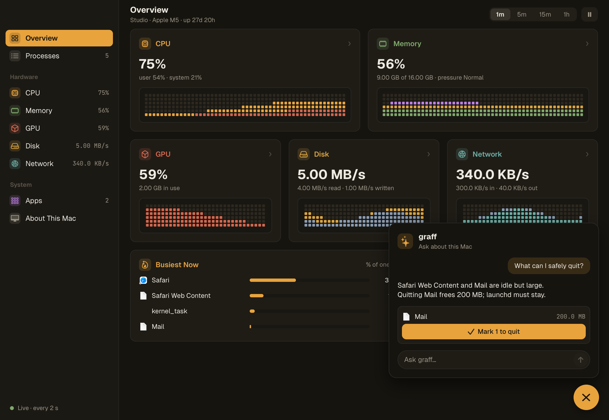
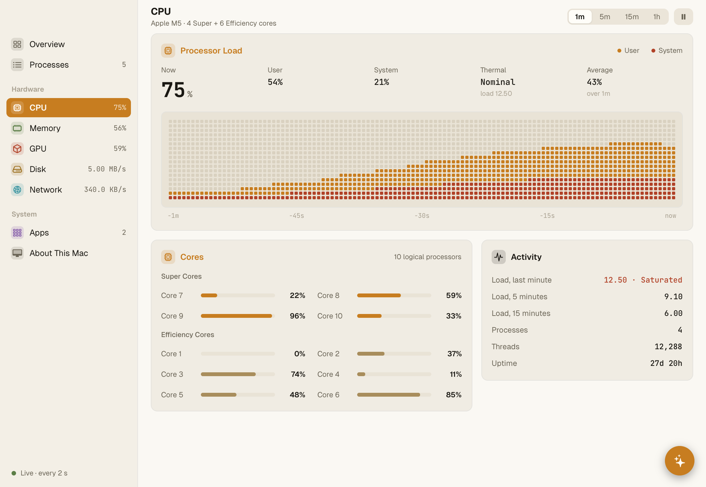
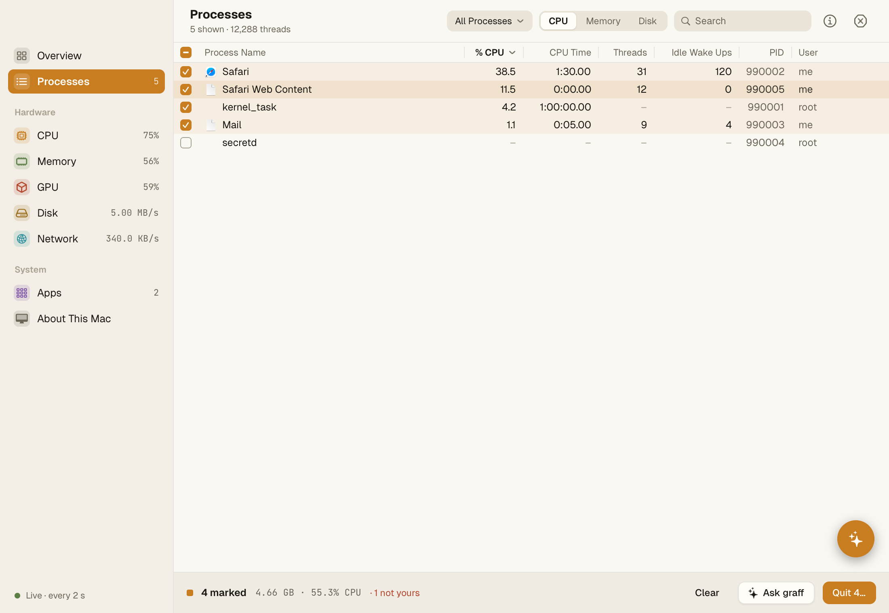

<p align="center">
  
</p>

<h1 align="center">nanomon</h1>

<p align="center">A small, smooth activity monitor for your Mac, with graff in the corner.</p>

<p align="center">Built on <a href="https://github.com/justrach/nanoui"><strong>nanoui</strong></a>, in Harness's Codegraff colors.</p>

<p align="center">
  
  
  
  
  
</p>

<p align="center">
  <a href="#download">Download</a> ·
  <a href="#get-started">Get started</a> ·
  <a href="#pages">Pages</a> ·
  <a href="#what-it-reads">What it reads</a> ·
  <a href="#using-it">Using it</a> ·
  <a href="#credits">Credits</a>
</p>

nanomon shows every process, the machine's CPU, memory, GPU, disk and network
over the last minute to hour, and what each app is using. It works out of the
box: no helper, no daemon, no admin rights. Its colors are amber, rust, sage,
slate and violet on warm charcoal or cream, set in Geist and JetBrains Mono.

## Download

**macOS** (Apple silicon, macOS 13+):
[download nanomon](https://github.com/justrach/nanomon/releases/latest/download/nanomon-macos-arm64.dmg),
open the disk image, and drag nanomon to Applications. Each
[release](https://github.com/justrach/nanomon/releases) lists the image's
SHA-256. Releases are built by
[`.github/workflows/release.yml`](.github/workflows/release.yml), and
`sh macos/package.sh` builds the same disk image locally.

## Get started

nanomon builds on its own. It fetches nanoui, pinned by commit in
`build.zig.zon`:

```sh
git clone https://github.com/justrach/nanomon
cd nanomon
zig build run
zig build test        # the model, ps's answers, the table, every page through ui.Tester, real samples
```

The tests write a picture of every page to `/tmp/nanomon-*.png`.

Working on nanoui at the same time? In a `--recursive` clone of
[nanoui](https://github.com/justrach/nanoui), nanomon lives under `apps/`.
Build it there against the nanoui next to it, with your changes, using
`--fork`:

```sh
cd nanoui/apps/nanomon
zig build run --fork=../..
```

## Pages

<p align="center">
  
  
</p>

- **Overview:** a tile for each part of the machine, with a small graph;
  the busiest processes; this Mac in a few lines.
- **Processes:** the full table, with All/My/System processes, CPU, Memory
  and Disk columns, search, an inspector and a quit sheet. Tick a row's box
  (or ⌘-click, or ⇧-click for a run of rows; the header's box ticks them
  all) to mark processes, then quit them together. The sheet names them
  first. Processes that aren't yours stay marked, and nanomon never
  signals itself, launchd or the kernel.
- **graff:** the amber bubble in the corner asks graff about the machine
  ("What's slowing my Mac down?", "Should I quit the 3 marked?"). It runs
  `graff -p --no-local-tools` from an empty temporary directory, so graff
  can answer but not act. graff sees the system's figures and the busiest
  and largest processes. If it names processes to quit, only your own are
  offered, as "Mark N to quit"; quitting them is still your call. Asking
  uses your graff account like any other graff run.
- **CPU:** the processor's load over a cell graph (system rust under user
  amber); each core's load with fast and frugal cores apart; load
  averages against the core count, tasks, threads and uptime.
- **Memory:** app, wired and compressed memory stacked over time, the
  pressure, and the largest processes.
- **GPU, Disk, Network:** the load or rates over time, totals since boot,
  and the processes that wrote the most.
- **Apps:** processes grouped by the app they belong to (Chrome and its
  helpers), with summed CPU, memory and threads.
- **About This Mac:** chip, cores, graphics, memory, system and uptime.

Graphs span 1 minute to 1 hour, and you can pause them. Hover a graph to read
the values in any column.

### In the menu bar

On macOS nanomon also sits in the menu bar, beside the clock. It shows CPU,
memory, the network's rates and the chip's temperature, in the menu bar's
own color. Click it to open a panel with:

- the CPU now, over its last minute in dots
- user, system, and how hot it runs
- every core as a ring, frugal and fast cores apart
- the five busiest processes
- the GPU's load, memory, temperature and renderer as dials
- load averages and uptime

Open nanomon brings up the window. The gear chooses what the menu bar shows
and quits nanomon. Closing the window leaves nanomon running in the menu bar.

## What it reads

Activity Monitor gets its figures from a private system daemon (sysmond,
through libsysmon), which reads every process. nanomon uses only public
interfaces:

- **Processes** (macOS): `proc_listallpids` lists them. `PROC_PIDTBSDSHORTINFO`
  gives each one's parent, user and short name, and `proc_pidpath` its
  program. A process inside an app bundle shows the app's name, as Activity
  Monitor does ("Google Chrome Helper (Renderer)").
- **CPU time and memory**: `proc_pid_rusage` gives these for the processes
  nanomon may read (the user's own, which is most of them). Memory is the
  physical footprint, the figure Activity Monitor shows. For the system's
  processes, nanomon asks `/bin/ps` (setuid, as `top` is) every third sample.
  It reads the answer as it arrives without waiting, and fills it in once
  it's there. ps reports resident memory for these, not the footprint.
- **The machine**: `host_processor_info` gives the CPU ticks per core.
  `host_statistics64` gives memory: app memory (anonymous, not purgeable),
  wired, compressed, and cached files (file-backed and purgeable).
- **Threads, idle wake ups and disk** (macOS): task info and rusage, for the
  processes nanomon may read. Activity Monitor's daemon reads them for every
  process; nanomon shows a dash for the rest.
- **Swap, memory pressure and the disks**: `vm.swapusage`,
  `kern.memorystatus_level`, and each block storage driver's statistics in
  IOKit.
- **The rest of the machine** (macOS):
  - **Each core's load:** `host_processor_info`, with fast and frugal cores
    told apart by `hw.perflevel*`.
  - **Load averages:** `getloadavg`.
  - **Every task and thread:** the default processor set's statistics.
  - **Thermal state:** NSProcessInfo.
  - **Temperatures:** the chip's sensors as IOKit's HID event system lists
    them. These are the CPU dies, the GPU's where the chip names them, and
    the rest of the SoC. They need no admin rights.
  - **The GPU:** its accelerator's statistics in IOKit.
  - **The network:** each interface's 64-bit counters from its MIB data. The
    routing socket gives only 32 bits to anyone but root.
- **Linux**: `/proc/<pid>/stat`, `statm`, `status` and `io`, plus
  `/proc/stat` (each core too), `/proc/meminfo`, `/proc/diskstats`,
  `/proc/loadavg`, `/proc/uptime` and `/proc/net/dev`. There's no GPU page
  data there.
- **Windows**: not yet. The app builds and says so.

% CPU is a share of one core over the last interval (two seconds), as
Activity Monitor counts it, so a busy process can pass 100%.

## Smooth and small

- **Sampling only while visible.** The view samples when it's due and asks
  for its next frame then (`c.frameIn`). A hidden or covered window samples
  nothing.
- **Smooth updates.** Rows are keyed by process ID, so a row's % CPU eases
  to each new value as its process moves through the table, and bars ease
  too.
- **Graphs draw only what changes.** A graph follows the pointer only while
  you hover it (`c.wants_moves`), and redraws its readout once when the
  hovered column changes.
- **Icons a few at a time.** App icons are made once per app, at most six
  per frame, so the first screenful doesn't stall.
- **A virtualized table.** Only the rows in view are built (`ui.list`), so
  two thousand processes cost what a screenful does.

There's no energy page: per-process energy and temperature come only from
Apple's private interfaces.

## Using it

- **Pages**: click the sidebar, or press ⌘1 to ⌘9.
- **Pause**: the ⏸ button beside the range, or ⇧⌘P.
- **Sort**: click a column; click it again to reverse the order.
- **Search**: type to filter by name, user or process ID (⌘F).
- **Select**: click a row, or move with ↑ and ↓.
- **Inspect**: double-click a row, press ⓘ or ⌘I.
- **Quit a process**: ⓧ or ⌥⌘Q. You're asked first. Quit sends SIGTERM,
  which asks the process to close; Force Quit sends SIGKILL.
- **Close**: Escape closes the open sheet or menu, then clears the selection.

## Files

```
src/main.zig          the window and the menu bar
src/menubar.zig       the menu bar readout (a template image) and its panel (macOS)
src/view_popover.zig  the panel under the menu bar
src/app.zig           state: sampling, order, search, selection, quitting
src/model.zig         processes, the system, sorting, formatting
src/sample.zig        a sample: CPU percentages, history, names, users
src/sample_mac.zig    libproc, Mach and sysctl
src/icons.zig         app icons for the table (macOS)
src/ps.zig            /bin/ps for the processes nanomon may not read
src/sample_linux.zig  /proc
src/sample_none.zig   elsewhere
src/sample_sys_mac.zig   chip, cores, load, uptime, threads, thermal, network
src/sample_iokit_mac.zig the disks and the GPU, from IOKit
src/sample_temp_mac.zig  temperatures, from IOKit's HID sensors
src/sample_sys_linux.zig the same from /proc
src/view.zig          the window: sidebar, page, sheets, keys
src/view_side.zig     the sidebar
src/view_kit.zig      headers, cards, figures, bars, ranges, the cell graph
src/view_overview.zig the overview
src/view_procs.zig    the processes page
src/view_table.zig    the process table
src/view_cpu.zig      CPU
src/view_memory.zig   memory and GPU
src/view_io.zig       disk and network
src/view_apps.zig     apps
src/view_about.zig    About This Mac
src/view_sheet.zig    the filter menu, the inspector, the quit sheets
src/view_graff.zig    the graff bubble and what it tells graff
src/graff.zig         running graff one-shot, reading its answer
src/tests_select.zig  marking, quitting together, the bubble (a fake graff)
src/theme.zig         the colors, light and dark
src/tests.zig         tests
src/tests_menubar.zig the panel and the readout
```

## License

nanomon's own code is licensed under the [MIT License](LICENSE). The parts derived
from CodeGraff (its colors, and the graff features, which work only with graff)
keep CodeGraff's original **modified AGPLv3**, kept verbatim in
[`third_party/licenses`](third_party/licenses/CodeGraff-LICENSE.txt); see
[third-party notices](THIRD_PARTY_NOTICES.md).

## Credits

- **[nanoui](https://github.com/justrach/nanoui):** windows, layout, text, the
  GPU and CPU renderers, and the Tester that draws every page offscreen.
  nanoui itself owes its design to
  [mygo](https://github.com/egoist/mygo) by
  [egoist](https://github.com/egoist), and to
  [GPUI](https://github.com/zed-industries/zed/tree/main/crates/gpui) by
  [Zed Industries](https://zed.dev).
- **egoist's activity monitor designs:** the sidebar of pages with live
  figures, and graphs drawn as columns of dots, which nanomon draws as square
  cells.
- **Apple's Activity Monitor:** what's worth showing, and how: memory split
  into app, wired, compressed and cached, % CPU as a share of one core, and
  the quit sheet. [rea](https://github.com/morluto/rea) helped show how
  Activity Monitor gets its figures.
- **[Harness](https://github.com/justrach/harness):** the Codegraff colors,
  and [graff](https://github.com/justrach/codegraff), the agent in the bubble.

<p align="center"><sub>Built in Zig 0.17 on <a href="https://github.com/justrach/nanoui">nanoui</a> · <a href="LICENSE">MIT</a> · <a href="THIRD_PARTY_NOTICES.md">third-party notices</a></sub></p>
